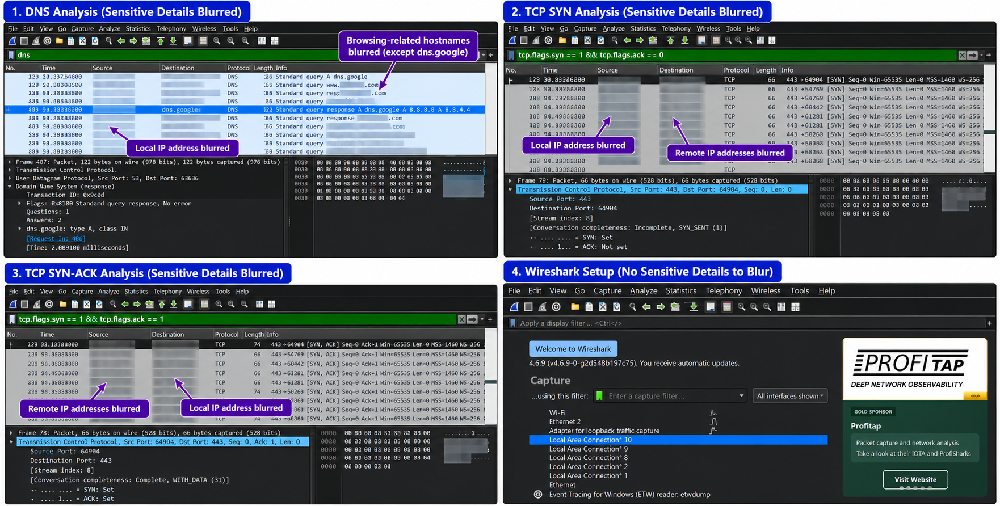

# Wireshark Network Traffic Investigation

## Project Overview

This project demonstrates basic network traffic investigation using Wireshark. Network traffic captured from my own computer was analyzed to examine DNS queries and responses, TCP connection activity, and TLS communication.

The objective was to practice packet analysis, use Wireshark display filters, document observations, and understand how network traffic can be investigated using packet-level evidence.

## Objectives

* Inspect DNS queries and responses.
* Identify TCP connection attempts and SYN-ACK responses.
* Examine TLS handshake messages and encrypted application traffic.
* Document observations in an investigation report.
* Practice evidence-based analysis and recognize investigation limitations.

## Tools and Environment

* **Operating System:** Windows
* **Network Analysis Tool:** Wireshark 4.6.9
* **Capture Interface:** Wi-Fi
* **Capture Format:** PCAPNG

## Investigation Process

### 1. DNS Analysis

**Display filter:**

```text
dns
```

DNS traffic was examined to identify queries and their corresponding responses.

The capture included an A-record query for `dns.google`. The corresponding response reported no DNS error and contained two IPv4 addresses:

* `8.8.8.8`
* `8.8.4.4`

This demonstrated how Wireshark can be used to inspect DNS queries, responses, and returned IP addresses.

### 2. TCP Connection Analysis

The following display filter was used to inspect initial TCP connection attempts:

```text
tcp.flags.syn == 1 && tcp.flags.ack == 0
```

The following filter was used to inspect TCP SYN-ACK packets:

```text
tcp.flags.syn == 1 && tcp.flags.ack == 1
```

TCP SYN and SYN-ACK packets involving local and remote hosts were observed.

This analysis demonstrated how TCP flags can help identify connection attempts and responses. These observations alone do not establish whether all connections completed successfully or whether any activity was malicious.

### 3. TLS Traffic Inspection

**Display filter:**

```text
tls
```

TLS 1.2 and TLS 1.3 traffic were observed in the capture.

The traffic included TLS handshake messages and encrypted application-data packets. A Server Name Indication (SNI) hostname was visible in a TLS Client Hello.

This demonstrated how Wireshark can identify TLS handshake activity and encrypted communication. The contents of encrypted application data were not interpreted.

## Key Findings

* DNS queries and responses were present in the capture.
* A DNS response for `dns.google` contained the IPv4 addresses `8.8.8.8` and `8.8.4.4`.
* TCP SYN and SYN-ACK packets were observed.
* TLS handshake messages and encrypted application-data packets were identified.
* The documented observations did not establish confirmed malicious activity.

## Evidence

The following image provides a visual overview of the Wireshark investigation, including DNS analysis, TCP SYN and SYN-ACK filters, and the Wireshark setup screen. Sensitive network details are obscured in the guide.



## Investigation Report

See [investigation_report.md](investigation_report.md) for the detailed investigation methodology, findings, conclusion, and limitations.

## Limitations

* The findings apply only to the traffic included in the captured session.
* TCP packet counts alone do not establish successful connections or malicious activity.
* TLS encryption limits visibility into application contents.
* An unfamiliar IP address, domain, or connection is not sufficient evidence of an attack.
* This project demonstrates basic network traffic analysis and is not a complete incident response exercise.

## Skills Demonstrated

* Wireshark packet analysis
* DNS query and response inspection
* TCP flag analysis
* TLS traffic inspection
* Display-filter usage
* Network evidence documentation
* Evidence-based investigation

## Responsible Use

Traffic was captured from my own computer for educational purposes. Packet captures can contain sensitive information, including IP addresses, hostnames, timestamps, and browsing-related metadata. Raw captures should be reviewed carefully and kept private unless appropriately sanitized for sharing.
